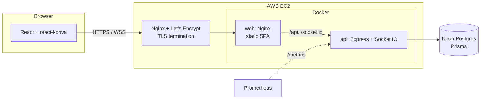

# Virtual Whiteboard

A real-time collaborative whiteboard. Multiple users can draw on the same canvas simultaneously with live cursors, role-based access, and history replay.

## Tech Stack

| Layer | Tech |
|---|---|
| Frontend | React 19 + TypeScript + Vite + Tailwind + react-konva |
| Backend | Node.js + TypeScript + Express + Socket.IO |
| Database | PostgreSQL (Neon) + Prisma |
| Auth | JWT + bcrypt |
| Deploy | AWS EC2 + Docker + Nginx + Let's Encrypt |
| CI/CD | GitHub Actions |

## Features

- [x] Auth (register / login)
- [x] Create / join boards via room code
- [x] Real-time drawing sync
- [x] Live multi-user cursors + presence
- [x] Role-based access (owner / editor / viewer)
- [x] Board versioning (event log + replay)
- [x] Export as PNG
- [x] Rate limiting + input validation
- [x] Structured logs + health + metrics
- [x] Integration tests

**Drawing tools:** pen, line, arrow, rectangle, ellipse, text and eraser, with 8 colours and 4 stroke widths. You can pan (hand tool, hold <kbd>Space</kbd>, or scroll) and zoom (<kbd>Ctrl</kbd>/<kbd>⌘</kbd> + scroll, pinch, or the zoom buttons). <kbd>Ctrl</kbd>/<kbd>⌘</kbd>+<kbd>Z</kbd> undoes your own last shape.

## Local Development

Requirements: Node.js 22+ (24 recommended). Docker is optional.

### 1. Install

```bash
cd backend && npm install
cd ../frontend && npm install
```

### 2. Configure the backend

```bash
cd backend
cp .env.example .env
```

Set `JWT_SECRET` to a random string of 32+ characters:

```bash
node -e "console.log(require('crypto').randomBytes(48).toString('base64url'))"
```

For `DATABASE_URL` you have two options:

- **No setup:** keep the default URL and start the bundled PGlite server, which is Postgres compiled to WASM:
  ```bash
  npm run db:local
  ```
- **Neon or any Postgres:** paste your connection string and set `DATABASE_POOL_SIZE=10`.

### 3. Migrate and run

```bash
# in backend/
npm run db:deploy   # apply migrations
npm run dev         # API + Socket.IO on http://localhost:4000

# in frontend/
npm run dev         # http://localhost:5173 (proxies /api and /socket.io to :4000)
```

Open http://localhost:5173, create an account, create a board, and share its room code. Open a private window as a second user to see live cursors.

### Running the whole stack with Docker

```bash
docker compose up --build
```

Then open http://localhost:8080. This runs Postgres, applies migrations, and starts the API and the Nginx-served frontend.

### Tests

```bash
cd backend && npm test    # integration tests (in-memory PGlite, or TEST_DATABASE_URL)
cd frontend && npm test   # unit tests
```

The backend suite starts the real Express + Socket.IO server and runs auth, board, role and realtime flows over HTTP and WebSockets against a database with the Prisma migrations applied.

## Architecture



**Event-sourced boards.** Boards are not stored as snapshots. Each change (`SHAPE_ADD`, `SHAPE_DELETE` or `CLEAR`) is appended to `board_events` with a sequence number that only goes up. The current board is the result of applying every event in order, and replay is the same fold stopped at an earlier event.

**Realtime flow:**

1. The client connects to Socket.IO with its JWT and emits `board:join`. The server checks membership and returns the user's role.
2. The client loads the event log over REST. Live events that arrive during the load are buffered and merged in by `seq`, so nothing is lost or applied twice. This repeats on every reconnect.
3. Each drawing action is applied locally first (optimistic), then sent as `board:event`. The server validates it with zod, checks the role against the database, saves it, and broadcasts it to the room.
4. Cursor positions and in-progress strokes use volatile messages. They are throttled on the client and never stored.

**Roles:**

| | Owner | Editor | Viewer |
|---|:-:|:-:|:-:|
| View board, replay, export | ✓ | ✓ | ✓ |
| Draw, erase, clear | ✓ | ✓ | |
| Rename, delete board, change roles, remove members | ✓ | | |

New members who join with a room code start as editors. Role changes and removals reach connected clients right away.

### Project structure

```
backend/
  prisma/              schema + migrations
  scripts/local-db.ts  zero-setup PGlite Postgres server
  src/
    config/env.ts      zod-validated environment
    lib/               logger, prisma, metrics, shape + request schemas
    middleware/        auth, rate limits, request logging, errors
    routes/            health, auth, boards (REST)
    services/          auth + board business logic
    realtime/          Socket.IO server, presence, token bucket
  test/                Vitest + Supertest + socket.io-client
frontend/
  src/
    auth/              session context + route guards
    board/             canvas, tools, realtime hook, replay, export
    pages/             Login, Register, Dashboard, Board
deploy/                EC2 compose file + host Nginx config
```

## API

All `/api/boards` routes require `Authorization: Bearer <token>`.

| Method | Path | Description |
|---|---|---|
| `POST` | `/api/auth/register` | `{ email, name, password }` → `{ user, token }` |
| `POST` | `/api/auth/login` | `{ email, password }` → `{ user, token }` |
| `GET` | `/api/auth/me` | Current user |
| `GET` | `/api/boards` | Boards you belong to |
| `POST` | `/api/boards` | `{ name }`: create a board (you become owner) |
| `POST` | `/api/boards/join` | `{ roomCode }`: join as editor |
| `GET` | `/api/boards/:id` | Board details and members |
| `PATCH` | `/api/boards/:id` | `{ name }`: rename (owner) |
| `DELETE` | `/api/boards/:id` | Delete (owner) |
| `PATCH` | `/api/boards/:id/members/:userId` | `{ role: "EDITOR" \| "VIEWER" }` (owner) |
| `DELETE` | `/api/boards/:id/members/:userId` | Remove a member (owner) or leave (self) |
| `GET` | `/api/boards/:id/events?after=&limit=` | Paginated event log |
| `GET` | `/health` | Liveness |
| `GET` | `/health/ready` | Readiness (checks the database) |
| `GET` | `/metrics` | Prometheus metrics (optionally bearer-protected) |

**Socket.IO events**

| Client → server | Server → client |
|---|---|
| `board:join` / `board:leave` `{ boardId }` (ack) | `presence` (users online) |
| `board:event` `{ boardId, type, payload }` (ack) | `board:event` (persisted event with `seq`) |
| `board:draft` `{ boardId, shape \| null }` | `board:draft`, `cursor:move`, `cursor:leave` |
| `cursor:move` `{ boardId, x, y }` | `board:role`, `board:deleted` |

### Hardening

- **Validation:** every request body, query and socket payload is checked with zod. Shapes are limited by point count, coordinates, colour format and text length.
- **Rate limiting:** login and register allow 20 failed attempts per 15 minutes. Other `/api` routes allow 300 requests per minute. Each socket has token buckets for committed events and for cursor/draft traffic.
- **Auth:** bcrypt with cost 12, and a constant-time path for unknown emails. JWTs expire. Boards you are not a member of return 404 rather than 403.
- **Observability:** pino JSON logs with request ids (`x-request-id`) and redacted secrets. `/metrics` exposes the HTTP latency histogram, socket connections, active boards and events by type.

## Deployment (AWS EC2)

CI builds three images on every push to `main` and pushes them to GHCR: `api`, `api-migrate` and `web`. Deploying is opt-in:

1. **Provision** an EC2 instance with Docker, the Compose plugin, Nginx and certbot. Point your domain's DNS at it.
2. **Copy** `deploy/docker-compose.prod.yml` and `deploy/.env.example` to `~/whiteboard/` on the instance. Rename the env file to `.env` and fill in your Neon `DATABASE_URL`, `JWT_SECRET`, `CORS_ORIGIN` and an optional `METRICS_TOKEN`.
3. **Log in to GHCR** if the images are private: `docker login ghcr.io`.
4. **Configure Nginx:** install `deploy/nginx/whiteboard.conf` in `/etc/nginx/sites-available/` with your domain, enable it, and issue the certificate with `sudo certbot --nginx -d your.domain`.
5. **Start:** run `docker compose -f docker-compose.prod.yml up -d`. Migrations run before the API starts.
6. **Turn on automatic deploys:** in GitHub, set the repository variable `DEPLOY_ENABLED=true` and the secrets `EC2_HOST`, `EC2_USER` and `EC2_SSH_KEY`.

> Presence is kept in memory, so the API runs as a single instance. To scale out, add the Socket.IO Redis adapter and a shared presence store.

## License

MIT
